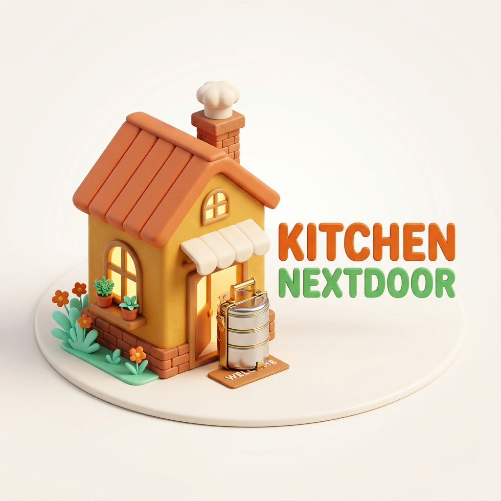
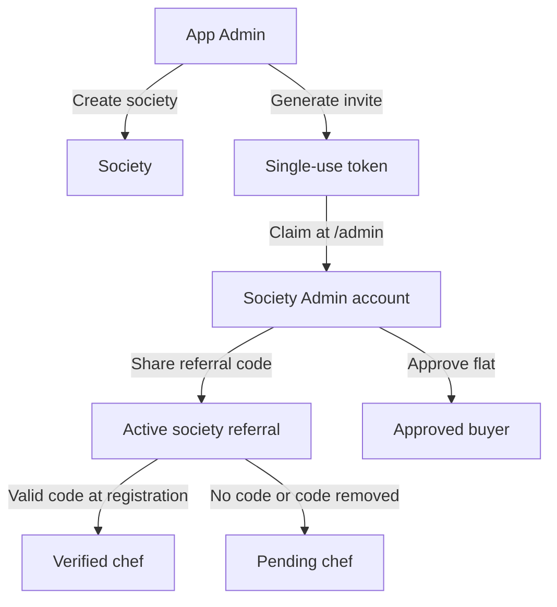
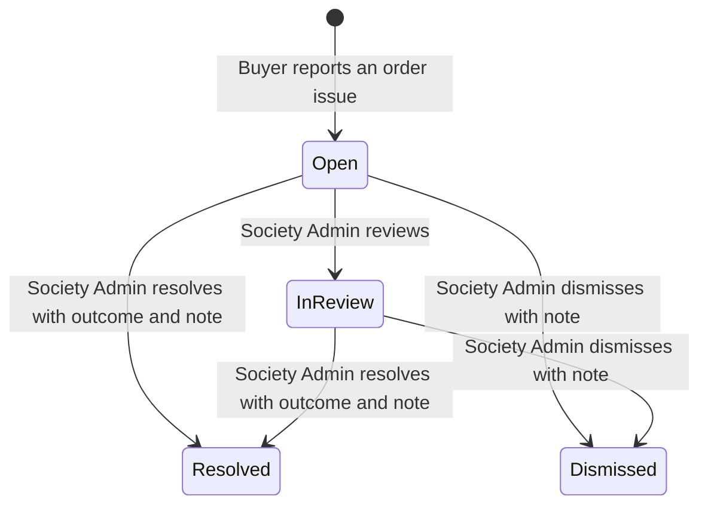
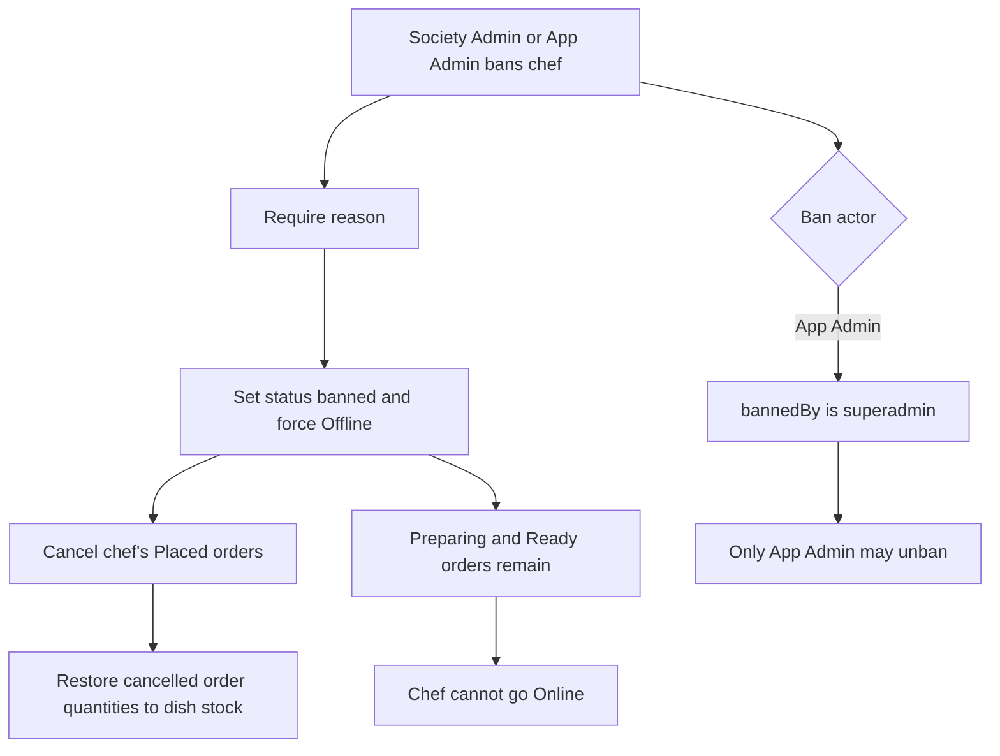
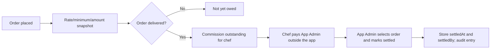
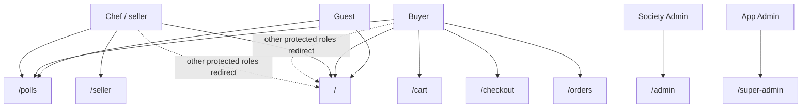

# KitchenNextDoor



KitchenNextDoor is a hyperlocal marketplace where verified residents cook at home and sell to neighbours inside their apartment society. Buyers browse their own community's menu, order from one or more home kitchens, and follow delivery or pickup orders. The current prototype is a client-side React application; its records and sessions live in the browser's `localStorage`.

## Table of contents

- [Features by role](#features-by-role)
- [Business rules](#business-rules)
- [Workflows](#workflows)
- [Technology and project structure](#technology-and-project-structure)
- [How to run](#how-to-run)
- [Test credentials](#test-credentials)
- [Routes](#routes)
- [Data model and browser storage](#data-model-and-browser-storage)
- [Testing report](#testing-report)
- [Known gaps and limitations](#known-gaps-and-limitations)
- [Roadmap](#roadmap)
- [Licence and credits](#licence-and-credits)

## Features by role

The role names in persisted accounts are `buyer`, `seller`, `admin`, and `superadmin`. A `seller` is the home chef; `admin` means the Society Admin.

### Guest

- Can browse the Food Menu and Society Polls after choosing a society. The menu and poll pages initially select the first society in the local list.
- Can use menu search and filters and view dishes, cooks, announcements, and reviews for the selected society.
- Cannot place orders or vote. Selecting a dish to order redirects a guest to `/login`; a guest who opens `/cart` is sent there by the route guard.
- The guest society picker is not shown when no societies exist; the menu then shows its empty states.

### Buyer

- All buyer accounts can browse the menu and polls for their registered society, view their own orders, and participate in polls.
- **Pending:** may browse but cannot check out. The menu, cart, and checkout show an approval notice; checkout's Place order button is disabled.
- **Approved:** may use the cart, check out, cancel an order while it is `Placed`, reorder, report an issue on an order, and vote in polls.
- **Rejected or suspended:** can still browse, but cannot order because checkout accepts only `approved` buyers. The UI currently uses the same generic approval notice rather than a distinct rejection/suspension notice.
- Can rate a chef only if that buyer has a delivered order from that chef. The review form is on the menu page; it accepts a 1–5 star rating and comment.
- Can see their own order list grouped into Active and Past, including order status, payment/delivery details, and issue progress.

### Chef / Seller

- **Pending:** can prepare their kitchen profile and dishes, but cannot go Online or take marketplace orders.
- **Verified:** can choose Online or Offline. Going Online requires a non-suspended society, at least one available in-stock dish, a valid UPI ID, and no overdue commission lock.
- **Banned:** is forced Offline, cannot go Online, and sees the recorded reason in Seller Studio. Unbanning restores `verified` status but leaves the kitchen Offline.
- Seller Studio tabs:
  - **Dashboard:** today's net earnings, pending orders, in-stock dish count, average rating, last-seven-day net earnings, top dishes, low-stock alerts, commission owed/settled, net take-home, and recent reviews.
  - **My Dishes:** add, edit, and delete dishes; edit price, category, stock, availability, photo, and customisation groups/choices.
  - **Orders:** view buyer/order/payment details; move eligible orders through preparation and ready to delivery, or reject a newly placed order. Rejecting restores stock. A clearly labelled testing-only “Simulate incoming order” action uses an in-stock dish.
  - **Polls:** chefs can post polls, vote, and close their own polls.
  - **Issues:** view issues filed against their kitchen and message the buyer or Society Admin while the issue is open.
- The chef's UPI ID is required at registration and can be changed in Seller Studio. A valid UPI ID is also required to go Online.

### Society Admin

Society Admin accounts can access `/admin` only for their assigned society. The console has:

- **Dashboard:** chef/buyer approval counts, orders today, open issues, seven-day gross order sales, active polls, top chefs by order count, and attention links for pending approvals and issues open over 24 hours.
- **Chefs:** search/filter, verify pending chefs, inspect dishes/rating/orders/commission/issues, and ban or unban chefs. A ban reason is required.
- **Referral:** copy or share the society's chef referral code, regenerate it, and activate/deactivate it.
- **Issues:** filter and review issues, see the order summary and conversation, add messages, mark `In review`, resolve with an outcome and required note, or dismiss with a required note.
- **Buyers and Polls:** approve/reject pending buyers, approve by mobile or flat, view all buyers, post/close/delete polls, and set or clear the society announcement.
- **Kitchens and Orders:** read-only kitchen presence/rating and society order lists with status filters.

The Society Admin cannot lift a platform-level App Admin chef ban. Banning a chef forces them Offline, cancels their `Placed` orders, and restores those dishes' stock; orders already Preparing or Ready are not cancelled.

### App Admin / Super Admin

The built-in App Admin enters `/super-admin`; a new browser profile must change its initial password before the console appears. The console tabs are:

- **Dashboard:** society, chef, buyer, today's order, delivered gross merchandise value, settled commission, outstanding commission, 30-day delivered-sales chart, top societies/chefs, and alerts.
- **Societies:** create/edit societies and commission values, inspect flat/chef/buyer/monthly-sales counts, suspend/reactivate a society, and generate its admin invite.
- **Society Admins:** inspect admins and last login, create/copy/revoke/regenerate invite tokens, replace an admin, and disable/enable an account.
- **Chefs:** cross-society search/filter, profile details and leaderboard, and platform ban/unban. Platform bans are tagged so a Society Admin cannot lift them.
- **Buyers:** search/filter, approve/reject/suspend/reactivate, and inspect order history and issues.
- **Orders and Issues:** read-only order filters, issue status totals, average resolution times by Society Admin, and issue list.
- **Commission:** inspect delivered-order commission by society and chef, select unsettled orders, mark settlement, and request a client-generated CSV report.
- **Settings and Audit:** set new-society commission defaults, token expiry, overdue days, change the App Admin password, and search/filter the newest-first audit log.

Commission settlement records that an amount was settled; it is not a payment processor or proof of a bank transfer. There is no per-issue admin payout feature.

### Society Polls, Cart, Checkout, My Orders, and Reviews

- **Society Polls (`/polls`):** shows only the signed-in user's society, or the guest-selected society. Buyers, chefs, and Society Admins may vote once per account per poll. Chefs and Society Admins may create polls in the current code; poll authors can close their own polls. The page treats a poll with a passed end time as closed even if the stored `closed` flag remains false.
- **Cart (`/cart`):** buyer-only route. Groups items by kitchen and shows choices, note, quantities, line totals and kitchen subtotal. It flags offline/hidden/sold-out/over-stock or changed-price/customisation items. Quantities are capped by current stock and checkout is blocked until cart issues are fixed.
- **Checkout (`/checkout`):** buyer-only route. Per kitchen, choose Doorstep or Pickup and UPI or Cash on Handover; the buyer's tower/flat prefill the delivery address. UPI requires the chef's UPI ID and a transaction reference. Orders have item totals only: no delivery or platform fee. A submission makes one order per kitchen and decrements stock.
- **My Orders (`/orders`):** buyer-only, shows newest orders in Active and Past groups. Buyers can cancel while `Placed` (stock is restored), reorder available dishes, report an issue, message on an open issue, and follow delivery status. The “Rate this cook” link points to the review form on the menu page.
- **Reviews:** the form lists cooks for whom the current buyer has at least one delivered order. The data layer re-checks that requirement when saving the review. Reviews are scoped to the cook's society.

## Business rules

| Topic | Behavior in the code |
|---|---|
| Browsing and ordering | `/` and `/polls` are public. Orders require a buyer whose status is exactly `approved`; guests and other roles cannot order. |
| Society selection | Buyers/chefs/admins are assigned a `societyId`. Guests choose a society on the menu and poll pages. Menu, polls, reviews, and console data use society filters. Legacy records without an ID attempt to resolve through their owner or society name. |
| Chef visibility | The menu displays only dishes of `verified`, Online chefs where `dish.available !== false`. A suspended society's chefs are forced Offline and new orders are blocked. |
| Referral verification | A chef registering with the selected society's matching active referral code becomes `verified`; no code means `pending`. An invalid/inactive non-empty code shows an inline error and blocks that submission; removing the code permits registration as pending. |
| Chef bans | Ban requires a reason, changes status to `banned`, forces Offline, and cancels/restocks only orders still `Placed`. `Preparing` and `Ready` orders remain. A Society Admin cannot unban a chef with `bannedBy: "superadmin"`. |
| Commission formula | `commission = min(orderTotal, max(orderTotal × rate / 100, minimum))`, rounded to two decimal places. Defaults are 5% and ₹5. The chef owes the commission; the buyer pays the listed menu price, without a platform fee. |
| Commission snapshot and settlement | The rate, minimum and amount are snapshotted on order creation. Later society rate changes do not recompute existing orders. Commission is counted as owed only for delivered statuses (`Delivered`, `Delivered and Paid`, or `Cash received and delivered`); Rejected and Cancelled orders do not accrue due. The App Admin records settlement with timestamp and actor ID. |
| Payments | There is no gateway. UPI is paid directly to the chef outside this application. Checkout requires a UPI transaction reference for UPI orders; Cash on Handover does not need one. |
| Order status | Normal seller actions are `Placed` → `Preparing` → `Ready` → `Delivered`. `Packed and Ready`, `Delivered and Paid`, and `Cash received and delivered` are also accepted by shared status/ledger logic for compatibility. `Rejected` and `Cancelled` are terminal states. |
| Reviews | Only a buyer with a delivered order from that chef may submit a review; the form requires a star selection and comment. |
| Polls | Polls have at least two non-empty options and are scoped to a society. Buyer, seller, and Society Admin accounts can vote once each. A chef or Society Admin can post; only the author can close. Passed end dates prevent voting and are shown as closed. |
| Society suspension | Registration in a suspended society is rejected, seller accounts are forced Offline, and checkout blocks its kitchens. Reactivation does not put chefs Online again. |
| Issue management | The order's buyer can report an issue with a category and description. The Society Admin can move it to `In review`, `Resolved`, or `Dismissed`; terminal actions require a note and store resolver ID/time. `Chef banned` as the resolved outcome also runs the chef ban flow. |

## Workflows

### Onboarding

1. The App Admin changes the built-in password, creates a society, and generates a single-use admin invite token.
2. The Society Admin claims the token at `/admin`; the claim creates the `admin` account, links it to the society, and consumes the token.
3. The Society Admin shares the society referral code from the Referral tab.
4. A chef registers with the selected society and referral. A valid active code verifies the chef immediately; otherwise the chef is pending manual verification.
5. A buyer registers as pending and needs approval before ordering.



### Order lifecycle and commission

```mermaid
stateDiagram-v2
    [*] --> Placed: Buyer checkout
    Placed --> Preparing: Chef starts
    Preparing --> Ready: Chef marks ready
    Placed --> Rejected: Chef rejects; stock restored
    Placed --> Cancelled: Buyer cancels or chef is banned; stock restored
    Ready --> Delivered: Chef confirms delivery/payment
    Delivered --> CommissionOwed: Snapshot enters due ledger
    CommissionOwed --> Settled: App Admin records settlement
```



One checkout creates one order for each kitchen represented in the cart. The stored commission snapshot is taken at placement; the order becomes due only after delivery.

### Issue lifecycle



Resolution outcomes available in the Society Admin UI are `No action`, `Warning to chef`, `Chef banned`, and `Settled between them`. Choosing `Chef banned` uses the resolution note as the ban reason. Closed issues reject further messages.

### Chef ban side effects



### Commission flow



The “chef pays App Admin” step above is an operational process outside the application. The app only records a manual settlement action.

### Role and route access



The route table below describes the actual route guard. `/admin` and `/super-admin` are intentionally absent from the public navigation; they render their staff login gate for unauthenticated or wrong-role visitors.

## Technology and project structure

### Stack

- React 18, React DOM, Vite 6, and React Router DOM 6.
- Plain CSS; no component library or chart library.
- React Context providers: `AuthContext` for the signed-in session and `CartContext` for cart state.
- Browser `localStorage` data access is in `src/api/auth.js` and `src/api/store.js`.
- DM Sans and Fredoka are requested from Google Fonts in `index.html`; system sans-serif fallbacks are defined in CSS.
- No server/backend, database, test framework, lint tool, or UI framework is configured in `package.json`.

### Important source tree

```text
src/
├── App.jsx                       Route declarations and role guards
├── main.jsx                      React root, BrowserRouter, and context providers
├── styles.css                    Public, seller, commerce, and admin styling
├── api/
│   ├── auth.js                   Login, registration, invite claim, session/password handling
│   └── store.js                  localStorage data layer and marketplace operations
├── context/
│   ├── AuthContext.jsx           Authentication/session React context
│   └── CartContext.jsx           Cart React context backed by store.js
├── components/
│   ├── SiteHeader.jsx            Shared public navigation/header
│   ├── StaffGate.jsx             Staff login, Society Admin invite claim, console gate
│   ├── ProtectedRoute.jsx        Role guard used by buyer and seller routes
│   ├── DishCard.jsx              Public menu dish card
│   ├── CustomiseModal.jsx        Dish choices, note, quantity and price
│   ├── DishForm.jsx              Seller dish editor and image compression
│   ├── OptionBuilder.jsx         Dish customisation group editor
│   ├── CartGroup.jsx             Cart items grouped by kitchen
│   ├── CartItem.jsx              Cart item quantity/removal controls
│   ├── OrderCard.jsx             Buyer order, cancellation, issue, reorder controls
│   ├── OrderRow.jsx              Seller order and status controls
│   ├── StatusStepper.jsx         Buyer-facing order progression
│   ├── PollCard.jsx / PollModal.jsx   Poll display and editor
│   ├── ReviewForm.jsx            Buyer review editor
│   ├── IssueReportModal.jsx      Buyer issue submission
│   ├── IssueThread.jsx           Issue conversation
│   ├── BanChefModal.jsx          Required-reason chef ban dialog
│   ├── StatCard.jsx / BarChart.jsx    Admin dashboard visualisations
│   ├── DataTable.jsx             Admin table renderer
│   └── ConfirmModal.jsx          App Admin confirmation dialog
└── pages/
    ├── HomePage.jsx              Food menu, guest society selection, review form
    ├── LoginPage.jsx             Buyer/chef login and registration
    ├── Polls.jsx                 Public and resident Society Polls
    ├── Seller.jsx                Seller Studio
    ├── Cart.jsx                  Buyer cart
    ├── Checkout.jsx              Buyer checkout and order confirmation
    ├── MyOrders.jsx              Buyer order history
    ├── SocietyAdmin.jsx          Society Admin console shell/actions
    ├── SuperAdmin.jsx            App Admin console shell/actions
    ├── admin/                    Society Admin dashboard/tab contents
    └── superadmin/               App Admin dashboard/tab contents
```

## How to run

### Prerequisites

- Node.js and npm. `package.json` does not declare a minimum Node.js engine.
- This README was prepared on Windows with Node.js `v24.18.0` and npm `11.16.0`.

### Install and start

```sh
npm install
npm run dev
```

Vite's default port is 5173; it selects the next available port if that port is already in use.

### Build and preview

```sh
npm run build
npm run preview
```

### Public assets

The actual files in `public/` are:

- `logo_full.png` — login card logo (note the underscore in the actual filename).
- `logo-house.png` — header logo and favicon.
- `hero-house.png` — Food Menu hero image.

The requested/older spelling `logo-full.png` is not present. The login page uses `/logo_full.png`.

### First App Admin login

- Email: `super@kitchennextdoor.app`
- The initial password is hard-coded in `src/api/auth.js` as `Admin@123`. It must be changed at first login, before the console is accessible.
- Credentials, session state, and account data are prototype-only browser storage. Do not use real credentials or deploy this setup as production authentication.

## Test credentials

> **Warning — local development only.** These fake accounts and fixtures are created by the development seeder and are not part of production builds. The built-in App Admin identity exists separately in production; its seeded test password does not. Never use these credentials with real data or deploy them.

To create the accounts, run `npm run dev`, open [`/dev`](http://localhost:5173/dev), and click **Load test data**. Alternatively, call `window.knd.seed()` in the browser console. The seeder clears the app's existing local data before rebuilding the fixtures. To wipe the app data, click **Clear all data** or call `window.knd.reset()`; refresh afterward so in-memory React contexts are reinitialized.

All seeded users use fake `+91 90000 000xx` mobile numbers. Each account can log in with the email shown below; password values are throwaway local test credentials.

| Role | Name | Login (email or mobile) | Password | Status | Where to log in (route) | What to test with it |
|---|---|---|---|---|---|---|
| App Admin / Super Admin | App Admin | `super@kitchennextdoor.app` | `TestAdmin@123` | Seeded `mustChangePassword: false` | `/super-admin` | Society setup, tokens, moderation, commission, settings, audit. |
| Society Admin | Test Admin | `admin@test.com` | `Test@1234` | Approved; linked to Test Heights via a claimed invite | `/admin` | Approvals, referral, announcement, polls, issue review, kitchens and orders. |
| Verified chef | Meera Test | `chef@test.com` | `Test@1234` | Verified, Online; kitchen “Meera's Test Kitchen” | `/login` → **I'm a home chef** | Menu visibility, customisations, stock, orders, commission, polls and issues. |
| Pending chef | Pending Chef | `pending.chef@test.com` | `Test@1234` | Pending, Offline | `/login` → **I'm a home chef** | Pending approval banner and Online lock. |
| Banned chef | Banned Chef | `banned.chef@test.com` | `Test@1234` | Banned, Offline; seeded ban reason is visible | `/login` → **I'm a home chef** | Ban reason display and Online lock. |
| Approved buyer | Rohan Test | `buyer@test.com` | `Test@1234` | Approved | `/login` → **I'm a neighbour** | Browse, checkout, My Orders, poll voting, review eligibility, and issue reporting. |
| Pending buyer | Pooja Test | `pending.buyer@test.com` | `Test@1234` | Pending | `/login` → **I'm a neighbour** | Browse-only state and order approval block. |
| Rejected buyer | Blocked Buyer | `blocked.buyer@test.com` | `Test@1234` | Rejected | `/login` → **I'm a neighbour** | Browse while blocked from ordering. |

The seeded Society Admin referral code observed in this run is **`KND-TES-2248`**. It is generated afresh and can change each time the seeder runs. Find the current code in the `/dev` seed summary or the Society Admin's **Referral** tab.

The seeded App Admin uses the test password above and skips the forced password-change gate. A normal first-time built-in App Admin still has to change the initial password before the console opens.

### Suggested test scenarios

- **App Admin:** add Test Heights' settings or inspect its delivered-order commission, settle it, and review the audit log.
- **Society Admin:** verify or inspect chefs, deactivate/regenerate the referral code, and resolve the open seeded issue.
- **Verified chef:** go through the placed order flow, adjust dish stock, and try UPI checkout with the seeded UPI ID.
- **Pending chef:** confirm the pending notice appears and Online is unavailable until a Society Admin verifies the account.
- **Banned chef:** confirm the seeded ban reason is shown and Online cannot be enabled.
- **Approved buyer:** view both seeded orders, report progress on the open issue, and use the delivered order to unlock the review form.
- **Pending buyer:** confirm the buyer can browse but cannot place an order until approved.
- **Rejected buyer:** confirm the buyer can browse but cannot place an order.

### Reset browser data

The application uses these exact keys:

```text
knd_users
knd_session
knd_superadmin_auth
knd_dishes
knd_reviews
knd_announcement
knd_cart
knd_polls
knd_orders
knd_commission_configs
knd_societies
knd_issues
knd_admin_tokens
knd_app_settings
knd_audit
```

Run this in DevTools Console on the app's origin to erase all KitchenNextDoor data for that browser origin:

```js
["knd_users","knd_session","knd_superadmin_auth","knd_dishes","knd_reviews","knd_announcement","knd_cart","knd_polls","knd_orders","knd_commission_configs","knd_societies","knd_issues","knd_admin_tokens","knd_app_settings","knd_audit"].forEach((key) => localStorage.removeItem(key))
```

This removes every society, account, order and setting, including the changed App Admin password; the built-in account will require the first-login password change again. It only clears storage for the origin where the command runs.

### First-time test walkthrough

1. Start the app and open `/super-admin`.
2. Sign in using the built-in App Admin email and initial password, then set a new password of at least eight characters.
3. In **Societies**, create a society and choose its commission rate/minimum (blank values use the configured defaults). Use **Generate admin invite token**.
4. Open `/admin`, choose **I have an invite token**, and claim the code with Society Admin details.
5. As Society Admin, copy/share the referral code from **Referral**.
6. Register a chef on `/login` with that society, a valid UPI ID, and the referral code. The account becomes verified; without a referral code it is pending and needs Society Admin verification.
7. As chef, add a dish with stock and optional choices, then go Online.
8. Register a buyer in that society and approve the buyer from **Buyers and Polls** as Society Admin.
9. As buyer, add dishes from one or more kitchens, select payment and delivery, enter the UPI reference if using UPI, and place the order.
10. As chef, move the order from Placed through Preparing and Ready, then confirm delivery/payment.
11. As App Admin, inspect **Commission**, select the delivered order, and mark it settled. Download the CSV if desired.
12. Use a clean browser profile/origin (or the reset command above) to repeat invite expiry/revocation and moderation tests without reusing existing accounts.

## Routes

| Path | Who can access it | Purpose |
|---|---|---|
| `/` | Everyone | Society-scoped Food Menu; guests use a society picker. |
| `/login` | Signed-out users; logged-in users are redirected | Buyer/chef login and registration. |
| `/polls` | Everyone | Society Polls; guests may browse, eligible signed-in residents may vote, chefs/admins may post. |
| `/cart` | `buyer` role | Cart. Signed-out users redirect to `/login`; any non-buyer role is redirected to `/`. |
| `/checkout` | `buyer` role | Checkout. The page additionally requires buyer status `approved` to submit. |
| `/orders` | `buyer` role | Current buyer's orders. |
| `/seller` | `seller` role | Seller Studio. Wrong roles redirect to `/`; signed-out users redirect to `/login`. |
| `/admin` | `admin` role for console; everyone else sees the StaffGate login/invite form | Society Admin console for the assigned society. |
| `/super-admin` | `superadmin` role for console; everyone else sees StaffGate login | App Admin console; built-in App Admin must first change password. |
| Any other path | Everyone | Redirects to `/`. |

## Data model and browser storage

Records are JSON values stored client-side, not database tables. Older data may omit `societyId`; the store attempts to resolve it from the owner account or matching society name.

| Record | Actual fields used by the app |
|---|---|
| User/account | Common: `id`, `name`, `mobile`, `email`, `password`, `role`, `status`, `societyId`, `society`, `createdAt`, `lastLoginAt`; residents also use `tower`, `flat`. Seller fields: `kitchenName`, `speciality`, `upiId`, `online`, `banReason`, `bannedAt`, `bannedBy`. Admin fields include `disabled`, `disabledAt`. The built-in App Admin credentials are stored separately. Password is plain text in this prototype. |
| Society | `id`, `name`, `address`, `city`, `adminId`, `referralCode`, `referralActive`, `expectedFlats`, `status` (`active`/`suspended`), `commissionRate`, `commissionMin`, `createdAt`. |
| Dish | `id`, `sellerId`, `societyId`, `name`, `description`, `category`, `veg`, `price`, `prepMins`, `stock`, `image`, `available`, `options`. Each option group has `name` and `choices`; each choice has `label` and `price`. |
| Order | `id`, `sellerId`, `societyId`, `buyerId`, `buyerName`, `buyerFlat`, `buyerPhone`, `items`, `total`, `deliveryMode`, `paymentMode`, `upiRef`, `status`, `note`, `commissionRate`, `commissionMin`, `commissionAmount`, `commissionSettled`, `settledAt`, `settledBy`, `createdAt`; delivered orders may also have `paymentConfirmed`. Each item stores `dishId`, `name`, `unit`, `qty`, `options`, and `note`. |
| Poll | `id`, `question`, `tag`, `options` (each has `id`, `label`), `votes` (user ID to option ID), `authorId`, `societyId`, `authorRole`, `authorLabel`, `endsAt`, `closed`, `createdAt`. |
| Issue | `id`, `societyId`, `orderId`, `raisedBy`, `raisedByName`, `sellerId`, `category`, `description`, `status`, `messages` (`by`, `role`, `text`, `at`), `outcome`, `resolutionNote`, `resolvedBy`, `resolvedAt`, `createdAt`. |
| Admin invite token | `id`, `societyId`, `code`, `status` (`unused`, `claimed`, `revoked`, or derived `expired`), `expiresAt`, `createdAt`, `claimedBy`, `claimedAt`. |
| Audit entry | `id`, `at`, `actorId`, `actorName`, `actorRole`, `action`, `targetType`, `targetId`, `details`. |
| Application settings | `commissionRate` (5), `commissionMin` (5), `tokenExpiryDays` (7), `overdueDays` (0, disabled). Existing societies retain their own commission values; defaults are used for new societies. |
| Commission configuration | `getCommissionConfig` returns `{ model: "percent_with_min", rate, minAmount }`. Society fields take precedence; a legacy `knd_commission_configs` record and then application defaults can provide fallback values. |

| `localStorage` key | Content |
|---|---|
| `knd_users` | Registered buyer, seller, and Society Admin accounts. |
| `knd_session` | Current signed-in session. |
| `knd_superadmin_auth` | Built-in App Admin password, forced-change flag, and last login. |
| `knd_societies` | Society records. |
| `knd_dishes` | Dish records and compressed image data. |
| `knd_orders` | Orders and commission snapshots/settlements. |
| `knd_cart` | Current browser cart. |
| `knd_reviews` | Cook reviews. |
| `knd_polls` | Polls and votes. |
| `knd_issues` | Buyer issue reports and messages. |
| `knd_admin_tokens` | Society Admin invite tokens. |
| `knd_app_settings` | Application defaults and overdue/token settings. |
| `knd_audit` | App Admin and Society Admin audit entries. |
| `knd_announcement` | Per-society announcement text. |
| `knd_commission_configs` | Legacy/fallback per-society commission configuration. |

## Testing report

### Dev seeder verification — 2026-10-19

- `npm run build`: **Pass**. Vite produced the production bundle.
- Production exclusion check: **Pass**. Searched built JavaScript and CSS for `Test Heights`, `Load test data`, `seedTestData`, both test passwords, `window.knd`, `/dev`, and dev-panel styles; none were present. The `/dev` route is added only under `import.meta.env.DEV`, and the console helper is dynamically imported only in development.
- Dev server: **Pass**. `npm run dev -- --host 127.0.0.1` served the app on port 5174 because port 5173 was occupied.
- Seeder and idempotency: **Pass**. Clicked **Load test data** twice. Both runs contained 1 society, 7 registered users, 3 dishes, 2 polls, 2 orders, 1 issue, and 1 invite token; no duplicate records appeared. The generated referral code changed as expected.
- Console helpers: **Pass**. Invoked `window.knd.reset()` and confirmed the app storage keys were cleared, then invoked `window.knd.seed()` and confirmed it recreated the fixture. The dev-only route and panel were visible at `/dev`.
- Test account logins: **Pass** for all eight accounts. Each was submitted in the browser at the requested route/tab, and the expected console or signed-in page/banner appeared:

| Account | Result | Notes |
|---|---|---|
| App Admin | Pass | `super@kitchennextdoor.app` logged in at `/super-admin` and opened the control center without the first-login gate. |
| Society Admin | Pass | `admin@test.com` logged in at `/admin` and opened the Test Heights console. |
| Verified chef | Pass | `chef@test.com` logged in on the Seller tab and opened Meera's Test Kitchen. |
| Pending chef | Pass | `pending.chef@test.com` logged in on the Seller tab and opened Seller Studio. |
| Banned chef | Pass | `banned.chef@test.com` logged in on the Seller tab and displayed the seeded ban reason. |
| Approved buyer | Pass | `buyer@test.com` logged in on the Buyer tab and opened the Food Menu. |
| Pending buyer | Pass | `pending.buyer@test.com` logged in on the Buyer tab and opened the Food Menu. |
| Rejected buyer | Pass | `blocked.buyer@test.com` logged in on the Buyer tab and opened the Food Menu. |

### Environment and commands

- OS: Windows.
- Node.js: `v24.18.0`; npm: `11.16.0`.
- `npm install`: completed successfully; reported two moderate vulnerabilities and an npm `allow-scripts` warning that the `esbuild@0.25.12` install script had not been approved.
- `npm run build`: **passed**. Vite 6.4.4 transformed 80 modules and emitted `dist/index.html`, one CSS bundle and one JS bundle.
- Lint: **not configured**. `package.json` has no lint script.
- Automated tests: **not configured/found**. `package.json` has no test script and there are no project test/spec files.
- Dev server: started successfully. Port 5173 was occupied, so Vite started on `http://127.0.0.1:5174/`; an HTTP request returned status 200.
- Browser check: the available browser opened the homepage on port 5174. The page rendered its menu and empty states; all images on that page loaded. React Router printed two v7 future-flag warnings. This was a smoke check, not an end-to-end feature test.
- Checklist below: **code-traced only** by following page and data-layer paths; the individual scenarios were not run interactively.

### Manual test checklist (code-traced)

| Area | Test case | Result | Notes |
|---|---|---|---|
| Auth | Register a buyer | Pass | `LoginPage` validates the mobile/society/flat and `auth.register` creates a pending buyer; login follows registration. |
| Auth | Register a chef without referral | Pass | A seller without a valid referral is saved `pending`; UPI ID is required. |
| Auth | Register a chef with valid active code | Pass | `validateReferralCode` is checked for the selected society; valid code sets `verified`. |
| Auth | Wrong/inactive referral code | Pass | Inline error blocks that submission. Clear the referral field and submit to register as pending. |
| Auth | Login and logout | Pass | `auth.js` saves/removes `knd_session`; login uses email/mobile and password. |
| Auth | Session persistence after refresh | Pass | `AuthProvider` initializes from `getSession()` and the session is in `knd_session`. |
| Auth | Role route guards | Pass | `ProtectedRoute` guards buyer/seller routes; StaffGate validates the expected staff role. |
| Auth | Admin routes absent from public navigation | Pass | `SiteHeader` links to menu, polls, Seller Studio (seller), My Orders (buyer), cart, and login/logout only. |
| Auth | Forced App Admin password change | Pass | `mustChangePassword` blocks the console until a password of at least eight characters is set. |
| Auth | Claim a valid admin invite | Pass | `claimToken` validates the token, creates an admin, assigns `society.adminId`, and marks the token claimed. |
| Auth | Claim an expired token | Pass | Expiry is checked against `expiresAt`; expired tokens are rejected. |
| Auth | Claim a revoked token | Pass | Revoked tokens are rejected with an explanatory error. |
| Auth | Reuse a claimed token | Pass | Claimed tokens are rejected on subsequent claims. |
| Menu | Empty menu/cook/review/poll states | Pass | Page components have empty-state branches for no dishes, cooks, reviews, and polls. |
| Menu | Search, vegetarian filter, category filter | Pass | `HomePage` filters visible dishes by name/kitchen/cook, veg choice, and category. |
| Menu | Offline chef dishes hidden | Pass | The menu requires verified + Online seller and an available dish. |
| Menu | Guest tries to order | Pass | `requestOrder` navigates an unsigned guest to `/login`. |
| Menu | Pending buyer ordering blocked | Pass | Menu action refuses; cart is blocked; checkout is disabled; `placeCheckout` validates approved status again. |
| Menu | Customisation price calculation | Pass | `CustomiseModal` adds selected choice prices to dish base price and quantity subtotal. |
| Seller Studio | Add, edit, delete dish | Pass | `Seller.jsx` calls the store CRUD functions and requires delete confirmation. |
| Seller Studio | Photo upload | Pass | `DishForm` validates image MIME, resizes to max 600px dimension, and stores a JPEG data URL. |
| Seller Studio | Customisation option builder | Pass | `OptionBuilder` edits groups and choices; the form drops empty groups/choices and rejects negative prices. |
| Seller Studio | Stock controls | Pass | Dish form validates nonnegative integer stock; seller controls increment/decrement with a zero floor. |
| Seller Studio | Online toggle locks | Pass | UI gates pending/banned status, suspended society, overdue commission, invalid/missing UPI ID, and no available in-stock dish. |
| Seller Studio | Order status progression | Pass | Store accepts Placed→Preparing→Ready/Packed and Ready/Packed→Delivered variants; seller controls expose these steps. |
| Seller Studio | Reject restores stock | Pass | `rejectOrder` accepts only `Placed`, sets `Rejected`, and restores item quantities. |
| Seller Studio | Simulate incoming order | Pass | Seller tab chooses a listed in-stock dish and calls `placeOrder`, which snapshots commission and decrements stock. |
| Seller Studio | Dashboard numbers | Pass | Dashboard sums delivered order totals, snapshots owed/settled, net earnings, pending orders, stock and ratings. |
| Cart/Checkout | Group by kitchen | Pass | Cart groups items by `sellerId` and computes per-kitchen subtotal. |
| Cart/Checkout | Quantity stepper and stock caps | Pass | Cart controls cap single-line quantity; `getCartIssues` checks aggregate quantities against stock. |
| Cart/Checkout | Offline kitchen flagged | Pass | Cart issue detection reports kitchens that are offline, unverified, suspended, or outside the buyer's society. |
| Cart/Checkout | UPI reference required | Pass | UI marks the reference required and `placeCheckout` validates it for UPI. |
| Cart/Checkout | One order per kitchen; stock decrement; cart clear | Pass | Checkout groups items by seller, creates one order per group, decrements stock, and clears `knd_cart` on success. |
| My Orders | Cancel while Placed | Pass | Buyer cancellation accepts only `Placed` and restores stock. |
| My Orders | Reorder available items | Pass | `reorderToCart` skips missing/unavailable/offline/sold-out dishes and returns skipped names. |
| My Orders | Report an issue | Pass | Buyer modal supplies category/description; `createIssue` checks that the buyer placed the order. |
| My Orders | Rate cook only after delivery | Pass | Homepage list and `addReview` both require a delivered order for the selected chef. |
| Commission | Minimum on small orders and rate on larger orders | Pass | `calcCommission` applies max(rate amount, minimum), caps at order total, and rounds to cents. |
| Commission | Snapshot unchanged after society rate change | Pass | New orders store `commissionRate`, `commissionMin`, and `commissionAmount`; society editing does not rewrite past orders. |
| Commission | Owed only after delivery; rejected/cancelled not due | Pass | `getCommissionDue` and ledger filter for delivered statuses only. |
| Commission | Mark commission settled | Pass | `markCommissionSettled` saves `commissionSettled`, `settledAt`, `settledBy`, and an audit record. |
| Polls | Chef and Society Admin can post | Pass | UI permits seller/admin authors; the store validates poll option content. |
| Polls | One vote per resident; guests cannot vote | Pass | Vote is stored by user ID and duplicate IDs are refused; guest has no voting identity. |
| Polls | Author closes poll | Pass | Close button appears for the author; store also checks `authorId`. |
| Polls | Auto-close at end date | Pass | Vote path blocks after `endsAt`; UI renders it closed based on current time. The `closed` flag is not automatically persisted. |
| Society Admin | Verify chef | Pass | `verifySeller` sets status to `verified` and writes an audit entry. |
| Society Admin | Ban and unban chef | Pass | Ban enforces a reason, takes chef offline, cancels/restocks Placed orders; unban returns verified/offline. |
| Society Admin | Referral regenerate/deactivate | Pass | Referral helper changes code/active state; Society Admin action writes audit entries. |
| Society Admin | Resolve/dismiss issue | Pass | Required note, outcome, resolver ID/time are saved; `Chef banned` runs ban logic. |
| Society Admin | Quick verify buyer | Pass | Quick verify searches pending/non-approved records by exact mobile or flat and returns an error if not found. |
| Society Admin | Save/clear announcement | Pass | Society Admin saves per-society text; blank text removes the announcement. |
| App Admin | Create/suspend society | Pass | Society creation applies configured defaults; suspension forces society chefs offline and checkout blocks it. |
| App Admin | Token generate/revoke/regenerate/claim lifecycle | Pass | Token helpers create, expire, revoke, regenerate, and claim tokens; claim is single-use. |
| App Admin | Replace Society Admin | Pass | Existing admin is disabled, society assignment is cleared, and a replacement invite is generated. |
| App Admin | Platform ban cannot be undone by Society Admin | Pass | App Admin ban sets `bannedBy: "superadmin"`; `unbanSeller` rejects non-superadmin attempts. |
| App Admin | CSV report | Pass | Code builds a delivered-order CSV and starts a browser Blob download. Actual file download was not exercised in this session. |
| App Admin | Audit log entries | Pass | Audit calls exist for settings, token, admin, society, buyer, chef, issue and commission actions. |
| App Admin | Disable an admin with an already-open session | Fail | `setAdminDisabled` updates storage, but `AuthContext` does not subscribe to cross-tab storage changes and Society Admin actions do not check `disabled`; an already-open admin tab can remain usable until reload. |
| Data isolation | Users see only their own society's marketplace/console data | Pass | Menu/polls and Society Admin data pass a society ID to store filters; buyer orders filter by buyer ID and society. This is client-side scoping, not a security boundary. |

**Checklist totals:** 58 Pass, 1 Fail, 0 Not tested. “Pass” means the corresponding logic was traced, not that every scenario was run in a browser.

### Failures and suggested fixes

| Finding | File(s) | Suggested fix |
|---|---|---|
| An App Admin disabling a Society Admin does not reliably revoke that admin's already-open session. | `src/api/store.js` (`setAdminDisabled`); `src/context/AuthContext.jsx`; `src/pages/SocietyAdmin.jsx` | Revalidate the current account's disabled state for privileged actions and synchronize/clear active sessions when account state changes. A production backend must enforce this server-side. |

### Earlier reports

No earlier test reports were found in the project source/root. This workspace is not a Git repository, so there is no local commit history to inspect for older reports. `node_modules` contains upstream package documentation and tests, not KitchenNextDoor project reports.

## Known gaps and limitations

- **Prototype persistence:** all records are browser `localStorage`; clearing site data deletes the app state. There is no API server, database, cross-device sync, or trusted server-side authorization.
- **Passwords and sessions:** account passwords are plain text in local storage. Role/session values can be changed by a user with DevTools. The built-in App Admin password is included in the source and changed credentials are stored locally. Real authentication must use server-side password hashing and authorization.
- **Invite tokens:** tokens are stored in the browser and generated with `Math.random`; they are not secure secrets without a backend and cryptographic random generator.
- **Payment:** UPI is a direct transfer to a chef; cash is handled outside the application. No payment gateway, reconciliation, refunds, or actual commission collection exists.
- **Commission settlement:** App Admin can mark a delivered-order commission settled, but the app does not collect or verify the chef's payment.
- **Image capacity:** dish images are compressed to JPEG data URLs at up to 600×600 and stored in local storage. Browser storage quotas are limited; use object storage for a real service.
- **Notifications:** there are no SMS, WhatsApp, push, or email notifications.
- **Issue operations:** there is no App Admin issue escalation and no payout/commission for Society Admin issue resolution.
- **Admin session disabling:** disabling an admin changes the stored record/session, but an already mounted AuthContext does not revalidate its user. See the failed checklist item above.
- **Poll creation policy:** the current implementation allows both chefs and Society Admins to create polls. This differs from the earlier product rule that only Society Admins create polls; the code and checklist behavior documented here reflect the actual current implementation.
- **Poll expiry:** a poll whose `endsAt` has passed is treated as closed for display/voting, but expiry does not write `closed: true` back to storage.
- **Logo filename:** the login page requests `/logo_full.png`; there is no `logo-full.png` file.
- **Browser font loading:** Fredoka and DM Sans are loaded from Google Fonts at runtime; offline use falls back to system sans-serif fonts.
- **No automated checks:** no test or lint scripts/frameworks are configured. Two moderate npm audit vulnerabilities were reported during the install used for this documentation task.
- **Legacy data:** old records can omit newer society/commission fields; the store has fallbacks, but migration coverage has not been exercised against a production dataset.

## Roadmap

1. Replace browser storage with a real backend and database, with server-side society/role authorization.
2. Add password hashing, secure sessions, token storage, expiry and cryptographically secure invite generation.
3. Integrate a payment gateway, refunds/reconciliation, and real commission collection/payout records.
4. Add buyer/chef/admin notifications over SMS, WhatsApp, email, or push.
5. Add Society Admin commission/payout accounting for issue resolution.
6. Add issue escalation to the App Admin.
7. Review GST, food-safety, business licensing, privacy, and consumer-protection requirements before launch.
8. Add automated unit/integration/e2e tests, linting, and production deployment/monitoring.

## Licence and credits

**Licence:** To be determined by the project owner. No licence file was present when this README was written.

**Credits:** KitchenNextDoor product and brand assets are supplied in `public/`. Fonts are requested from Google Fonts (Fredoka and DM Sans). Add attribution and asset licensing details here before redistribution or commercial deployment.
